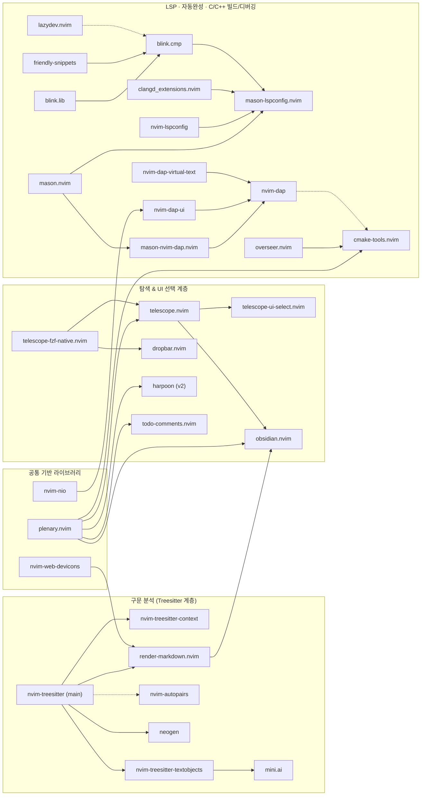

# Plugin Architecture & Dependencies (플러그인 구조와 의존성 원리)

이 문서는 `lua/plugins/` 아래에 구성된 모든 플러그인의 목록, 서로 간의 의존성 관계도, 그리고 **`lazy.nvim` 환경에서 플러그인들이 어떻게 서로를 의존하고 데이터를 주고받는지**를 설명합니다.

---

## 1. 플러그인들이 서로를 의존하게 만드는 4가지 방식

Neovim 플러그인 생태계에서 "A 플러그인이 B 플러그인에 의존한다"는 것은 단순히 설치 순서만 뜻하지 않고, 아래 **4가지 계층**으로 작동합니다.

### ① 로드 순서 보장 (`lazy.nvim`의 `dependencies` 키)
플러그인 스펙에 `dependencies = { "송신측/플러그인" }`을 적으면, `lazy.nvim`은 **부모 플러그인이 로드되기 직전에 의존성 플러그인을 먼저 설치하고 런타임 경로(`runtimepath`)에 올려 `setup()`까지 마칩니다.**
- 예: [`lua/plugins/telescope.lua`](../lua/plugins/telescope.lua)가 `nvim-lua/plenary.nvim`을 `dependencies`에 선언하면, `telescope` 내부 코드가 `require("plenary.async")`를 호출할 때 모듈을 찾지 못하는 에러가 원천 차단됩니다.
- 반대로 부모 플러그인이 지연 로드(`event = "VeryLazy"`, `ft = "cpp"`, `keys = ...`)로 묶여 있으면, 다른 곳에서 먼저 요구하지 않는 한 의존성 플러그인도 함께 지연 로드되어 시작 속도를 지킵니다.

### ② 설정 테이블 병합 (`opts` Spec Merging)
`lazy.nvim`은 여러 파일에서 **같은 플러그인 이름**을 반환하더라도 `opts` 테이블(또는 `opts = function(_, opts)`)을 순서대로 병합한 뒤 마지막에 `config(_, opts)`를 단 한 번 실행합니다.
- 예: [`lua/plugins/telescope.lua`](../lua/plugins/telescope.lua)에는 기본 검색 설정(`defaults`)만 두고, [`lua/plugins/ui-select.lua`](../lua/plugins/ui-select.lua)에서 `nvim-telescope/telescope.nvim`의 `opts`에 `extensions["ui-select"]` 항목만 덧붙입니다.
- 덕분에 기존 파일을 복잡하게 건드리지 않고도, `telescope.setup(opts)` 재호출로 기존 설정이 초기화되는 문제를 피하면서 모듈식으로 기능을 확장할 수 있습니다.

### ③ 런타임 API · Capabilities · 어댑터 주입
로드 순서가 보장된 뒤에는 Lua 함수 호출을 통해 한 플러그인의 기능을 다른 플러그인의 백엔드/프론트엔드로 연결합니다.
- **LSP ↔ 자동완성**: [`lsp.lua`](../lua/plugins/lsp.lua)에서 `require("blink.cmp").get_lsp_capabilities()`로 자동완성 스펙을 뽑아 `vim.lsp.config("*", ...)`에 주입함으로써 LSP 서버(`clangd`, `lua_ls`)가 스니펫·추가 편집 기능을 지원한다는 사실을 알게 됩니다.
- **CMake ↔ 태스크 러너 & 디버거**: [`cmake.lua`](../lua/plugins/cmake.lua)의 `cmake-tools.nvim`은 빌드/실행 출력을 직접 그리는 대신 `cmake_executor`와 `cmake_runner` 이름으로 `"overseer"`를 지정해 `overseer.nvim` 창에 위임하고, `:CMakeDebug` 실행 시 `nvim-dap`의 `"codelldb"` 어댑터를 호출합니다.
- **자체 모듈 ↔ 플러그인 동기화**: [`obsidian.lua`](../lua/plugins/obsidian.lua)는 직접 작성한 [`custom/bases/workspace.lua`](../lua/custom/bases/workspace.lua)의 `get_obsidian_workspaces()`를 읽어 볼트 목록을 구성하고, 워크스페이스가 추가/변경될 때 콜백으로 `obsidian.setup()`을 다시 호출해 실시간 연동합니다.

### ④ 외부 바이너리 및 파서 의존성 분리
Lua 코드 외에 OS에 설치되어야 하는 실행 파일은 전담 매니저 플러그인이 관리합니다.
- **`mason.nvim`**: LSP/디버거/포매터 실행 파일 다운로드 (`~/.local/share/nvim/mason/bin`)
  - `mason-lspconfig.nvim`: Mason 패키지 이름(`lua_ls`, `clangd`, `neocmake`)을 Neovim 내장 `vim.lsp.enable()`과 자동 매핑
  - `mason-nvim-dap.nvim`: Mason의 `codelldb` 바이너리를 `nvim-dap` 어댑터에 자동 등록
- **`nvim-treesitter`**: C 컴파일러와 `tree-sitter` CLI를 호출해 각 언어 문법 파서(`.so`/`.dll`)를 컴파일하고, 이를 `treesitter-context`, `treesitter-textobjects`, `mini.ai`, `render-markdown`, `neogen`, `nvim-autopairs`가 공유해 구문 트리를 분석합니다.

---

## 2. 플러그인 의존성 관계도

---

## 3. 파일별 플러그인 및 의존성 일람 (`lua/plugins/`)

| 설정 파일 | 포함 플러그인 | 직접 의존성 (`dependencies` / 연동) | 로드 시점 (Trigger) | 핵심 역할 |
| :--- | :--- | :--- | :--- | :--- |
| [`lsp.lua`](../lua/plugins/lsp.lua) | `mason.nvim` `nvim-lspconfig` `clangd_extensions.nvim` `mason-lspconfig.nvim` | `blink.cmp` (capabilities 주입) | 기본 로드 (`clangd_extensions`는 C/C++ 파일 열 때) | LSP 바이너리 자동 설치(`lua_ls`, `clangd`, `neocmake`) 및 네이티브 LSP 키맵 연결 |
| [`lazydev.lua`](../lua/plugins/lazydev.lua) | `lazydev.nvim` `blink.cmp` | `blink.lib` `friendly-snippets` | `lazydev`: `ft=lua` `blink.cmp`: 기본 로드 | Neovim Lua API 타입 추론 및 고속 자동완성·스니펫 엔진 |
| [`confirm.lua`](../lua/plugins/confirm.lua) | `conform.nvim` | `:Mason` 포매터 바이너리, 폴백 시 LSP | `BufWritePre`, `:ConformInfo`, `<leader>cf`/`tf` | 언어별 코드 포매터 실행 및 저장 시 자동 포맷 |
| [`cmake.lua`](../lua/plugins/cmake.lua) | `overseer.nvim` `cmake-tools.nvim` | `plenary.nvim`, `overseer.nvim`, `nvim-dap` (`codelldb`), `clangd` (`didChangeWatchedFiles`) | C/C++/CMake 파일 열 때 또는 `<leader>c*` / `<leader>o*` | Ninja·병렬 빌드, 최신(`mtime`) `compile_commands.json` 루트 자동 링크/복사, CTest·디버거 런처 |
| [`dap.lua`](../lua/plugins/dap.lua) | `nvim-dap` `nvim-dap-ui` `nvim-dap-virtual-text` `mason-nvim-dap.nvim` | `nvim-nio`, `mason.nvim` | `<F5>`~`<F12>`, `<leader>b`, `<leader>d*` 입력 시 | `codelldb` 자동 설치, 중단점·콜스택·변수 UI 및 코드 옆 실시간 변수 값 표시 |
| [`treesitter.lua`](../lua/plugins/treesitter.lua) | `nvim-treesitter` (`main`) | `tree-sitter` CLI, C/C++ 컴파일러 | 즉시 로드 (`lazy = false`) | 14개 주요 언어 파서 자동 설치, 구문 하이라이팅 및 들여쓰기 |
| [`treesitter-context.lua`](../lua/plugins/treesitter-context.lua) | `nvim-treesitter-context` | `nvim-treesitter` | `BufReadPost`, `BufNewFile` | 스크롤 시 상단에 현재 함수/클래스/`#ifdef`/`template` 시그니처 고정 |
| [`text_obj.lua`](../lua/plugins/text_obj.lua) | `nvim-treesitter-textobjects` `mini.ai` | `nvim-treesitter` | 파일 열 때 / `VeryLazy` | 함수·클래스·인자 이동(`]f`, `]c`, `]a`), 인자 스왑(`<leader>a`), 확장 텍스트 객체(`af`, `va<`) |
| [`editing.lua`](../lua/plugins/editing.lua) | `mini.surround` `nvim-autopairs` | `nvim-treesitter` (`check_ts`) | `VeryLazy` / `InsertEnter` | 괄호·따옴표 감싸기/교체/삭제(`gs*`) 및 입력 시 괄호 자동 닫기 |
| [`telescope.lua`](../lua/plugins/telescope.lua) | `telescope.nvim` `telescope-fzf-native.nvim` | `plenary.nvim` (`make` 빌드) | 기본 로드 | 프로젝트 파일·문자열·버퍼·도움말·명령어 퍼지 파인더 |
| [`ui-select.lua`](../lua/plugins/ui-select.lua) | `telescope-ui-select.nvim` | `telescope.nvim` (`opts` 병합) | `VeryLazy` | `vim.ui.select`(코드 액션, CMake 타겟 선택)를 Telescope 드롭다운으로 대체 |
| [`navigation.lua`](../lua/plugins/navigation.lua) | `flash.nvim` `harpoon` (`harpoon2`) | `plenary.nvim`, `custom.bases.workspace`(`tcd` 경로 키 공유) | `VeryLazy` / 단축키 입력 시 | 화면 내 2~3타 순간이동(`s`) 및 워크스페이스별 핵심 파일 핀 고정(`<leader>1`~`4`) |
| [`trouble.lua`](../lua/plugins/trouble.lua) | `trouble.nvim` `todo-comments.nvim` | `nvim-web-devicons`, `plenary.nvim`, `telescope.nvim` | `:Trouble`, 파일 열 때, `<leader>x*` / `<leader>ft` | 진단 에러·LSP 참조·심볼 트리 고정 창 및 `TODO`/`FIXME` 주석 관리 |
| [`gitsigns.lua`](../lua/plugins/gitsigns.lua) | `gitsigns.nvim` | 시스템 `git` | `BufReadPre`, `BufNewFile` | 좌측 거터 변경 표시, Hunk 스테이징/리셋/미리보기, 줄별 Git Blame |
| [`lazygit.lua`](../lua/plugins/lazygit.lua) | `lazygit.nvim` | `plenary.nvim`, 외부 `lazygit` CLI | `:LazyGit`, `<leader>lg` | Neovim 내부 플로팅 LazyGit TUI 실행 |
| [`oil.lua`](../lua/plugins/oil.lua) | `oil.nvim` | `nvim-web-devicons` | 즉시 로드 (`default_file_explorer`) | 일반 텍스트 버퍼처럼 파일·폴더를 편집하는 탐색기 (`netrw` 대체) |
| [`dropbox.lua`](../lua/plugins/dropbox.lua) | `dropbar.nvim` | `telescope-fzf-native.nvim`, LSP / Treesitter | 기본 로드 | 상단 Winbar에 경로 + 클래스·함수 문맥 브레드크럼 표시 |
| [`bufferline.lua`](../lua/plugins/bufferline.lua) | `lualine.nvim` | `nvim-web-devicons`, [`custom/bases/lualine.lua`](../lua/custom/bases/lualine.lua) | `VeryLazy` | 하단 전역 상태바 (현재 워크스페이스명, 매크로 녹화 상태, 활성 LSP 표시) |
| [`notify.lua`](../lua/plugins/notify.lua) | `nvim-notify` | - (`vim.notify` 전역 교체) | `VeryLazy` | 우측 상단 애니메이션 알림 팝업 (워크스페이스·포맷·Harpoon 알림 통합) |
| [`obsidian.lua`](../lua/plugins/obsidian.lua) | `obsidian.nvim` `render-markdown.nvim` | `plenary.nvim`, `telescope.nvim`, `nvim-treesitter`, `nvim-web-devicons`, `custom.bases.workspace` | 기본 로드 (`render-markdown`은 `ft=markdown`) | 모든 등록 워크스페이스의 `README.md` + `docs/` 노트 관리 및 마크다운 인라인 렌더링 |
| [`doxygen.lua`](../lua/plugins/doxygen.lua) | `neogen` | `nvim-treesitter`, 내장 `vim.snippet` | `:Neogen`, `<leader>nf`/`nc`/`nF` | C/C++/Lua 함수·클래스·파일 Doxygen 주석 자동 생성 |
| [`which-key.lua`](../lua/plugins/which-key.lua) | `which-key.nvim` | 각 키맵의 `desc` 메타데이터 | `VeryLazy`, `<leader>?` | 단축키 입력 대기 시 사용 가능한 하위 키맵 팝업 가이드 표시 |
